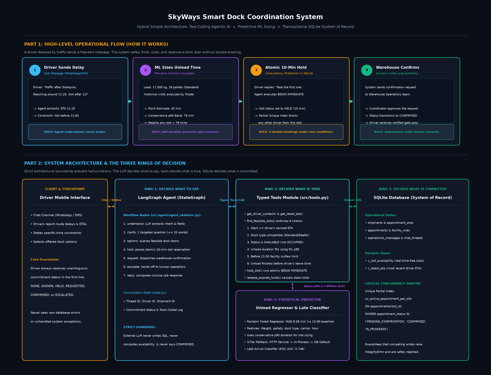

# SkyWays Smart Dock Coordination System

Automated freight exception resolution and dock scheduling under concurrency for truck drivers and warehouse coordinators.



---

## The Problem

Two operations coordinators can offer the exact same warehouse dock slot to two delayed truck drivers within two minutes because dock availability was a human reading of a screen rather than a computed, exclusive state. On 4 August 2026 at Jaipur Distribution Centre (`FAC-JAI-01`), `SLOT-JAI-019` was offered simultaneously to two inbound drivers, creating cascading yard congestion and uncompensated driver detention.

Detailed root-cause analysis is documented in [Five Whys Worksheet](docs/five_whys.md).

---

## What It Does

- **Understands driver delay messages in natural cab language:** Extracts revised arrival times, constraints, and equipment needs from free-form text, asking at most one targeted clarifying question when details are missing.
- **Finds and sizes feasible dock doors with ML duration models:** Applies six physical and operational constraints against live facility status while using conservative p90 unload duration predictions to ensure trucks fit before doors close.
- **Reserves slots atomically under concurrency without double-booking:** Places temporary 10-minute holds with database-level uniqueness enforcement, alerts the warehouse for formal confirmation, and escalates out-of-scope issues to human staff.

---

## Demo

To run the live demonstration locally from a clean state:

```bash
# 1. Restore the database to the clean demonstration snapshot
python scripts/snapshot_db.py restore

# 2. Run the interactive driver coordination console
python src/agent/agent_skeleton.py

# 3. Prove concurrency guarantees (4 concurrent holds on 1 slot -> exactly 1 winner)
python scripts/replay_scenario.py
```

---

## Proof

| Claim | Evidence / Command Output |
| :--- | :--- |
| **Zero double-bookings under concurrent hold races** | `pytest tests/test_no_double_booking.py -v` (1/1 passed)<br>`python scripts/replay_scenario.py` $\to$ `PASS, exactly one hold` (1 HELD, 3 REJECTED) |
| **100% benchmark evaluation pass rate** | `pytest tests/test_eval_cases.py -v` (12/12 passed across happy path, clarification, constraints, escalation, concurrency, duplicate) |
| **Unload ML model beats dock-type median baseline by 41.9%** | `src/model/unload_predictor.joblib`<br>Test MAE: **8.08 min** vs Baseline MAE: **13.90 min** on time-ordered July 1 split (`docs/eval_report.md`) |
| **HistGradientBoosting delay classifier outperforms baseline** | `src/model/hist_gradient_boosting_classifier.joblib`<br>Accuracy: **70.1%** vs Baseline: **53.6%**, ROC AUC: **0.751**, Brier: **0.201** |
| **Predictor integration contract honoured with 300ms SLA & fallback** | `pytest tests/test_day8.py -v` (5/5 passed)<br>In-process joblib fallback and database default guarantee sub-300ms SLA (`src/hybrid/integration_contract.md`) |
| **Full automated regression suite passes cleanly** | `pytest tests/ -v` (**51/51 passed** across all 6 test suites in 33s) |

---

## Limits and Next Steps

### Three Known Limits
1. **Single-Facility Rolling Horizon:** The system resolves delays for individual arriving trucks at their destination facility; it does not solve multi-stop global combinatorial network re-routing.
2. **Human-in-the-Loop Confirmation:** A slot is held as `PENDING_CONFIRMATION` until warehouse staff approve it; the autonomous system never unilaterally commits dock capacity without human sign-off.
3. **Static Hold Expiry Window:** Slot reservations currently expire after a fixed 10-minute window regardless of driver distance or traffic severity.

### Next Steps
1. **OR-Tools Rolling Horizon Rescheduling:** Formulate trucks as jobs and dock doors as machines using CP-SAT to re-optimize 4-hour receiving windows whenever an ETA shifts. *(Effort: 6 days)*
2. **Background Hold Expiry and Release Worker:** Implement an asynchronous background daemon calling `release_expired_holds()` periodically to auto-reclaim abandoned holds back to `AVAILABLE`. *(Effort: 1 day)*

---

## Data

All records are based on the synthetic SkyWays classroom dataset (snapshot timestamp: **4 August 2026, 10:30 IST**):
- **21 live shipments** across 2 receiving facilities (`FAC-JAI-01` Jaipur, `FAC-GGN-01` Gurugram).
- **6,040 historical dock visit logs** (February–July 2026) for ML duration regression and delay classification.
- **148 labelled driver chat messages** for intent classification and entity extraction benchmarking.
- Schema definitions and field semantics are available in [`data/skyways_data_dictionary.csv`](data/skyways_data_dictionary.csv).

---

## Architecture and ADRs

- [System Architecture & C4 Diagrams](docs/architecture.md)
- [ADR-001: Hybrid Simple Architecture & Database Concurrency](docs/adr/adr_001_hybrid_simple.md)
- [Model Evaluation Report](docs/eval_report.md)
- [PRD-Lite Specification](docs/prd_lite.md)
- [Predictor Integration Contract](src/hybrid/integration_contract.md)
