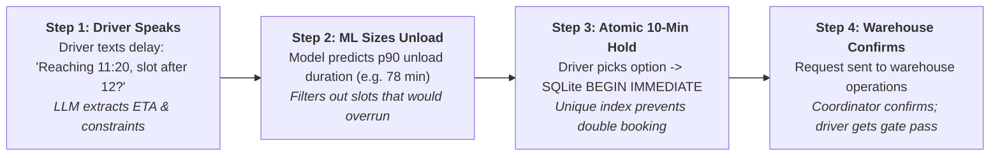

\# SkyWays Smart Dock Coordination — Architecture


\## 1. High-level flow: How it works in 4 simple steps

A delayed driver sends one short message from the cab. Here is how the system safely finds, sizes, and books a dock door without double-booking:



### The Three Golden Rules
1. **The LLM decides what to say, never what is booked:** It parses language and formats responses, but cannot execute SQL or declare a booking confirmed.
2. **Tools & ML decide what is true:** Physical compatibility, facility hours, and conservative p90 unload durations decide which slots are feasible.
3. **The database decides what is committed:** The partial unique index `ux_active_appointment_per_slot` is the sole arbiter of capacity. Two concurrent holds on the same slot result in exactly one winner and zero double bookings.

---

## 2. Architecture overview


SkyWays uses a Simple Hybrid architecture.


\- \*\*Agentic AI (LangGraph):\*\* Understands driver messages, extracts shipment information, asks clarifying questions, finds options, and coordinates appointment requests.

\- \*\*Machine Learning:\*\* Predicts unloading duration and provides a conservative p90 estimate.

\- \*\*SQLite:\*\* Remains the source of truth for shipments, appointments, slot availability, and hold expiry.

\- \*\*Warehouse operations:\*\* Retain authority to confirm appointment requests.


The LLM cannot directly modify appointment records or declare an appointment confirmed.


\## 2. System context diagram


```mermaid

flowchart LR

&#x20;   D\[Driver]

&#x20;   O\[Operations Coordinator]

&#x20;   W\[Warehouse Planner]


&#x20;   S\[SkyWays Smart Dock Coordination System]


&#x20;   L\[LLM Service via OpenRouter]

&#x20;   M\[Unloading Duration Predictor]

&#x20;   DB\[(SQLite Operational Database)]


&#x20;   D -->|Delay messages and choices| S

&#x20;   S -->|Clarifications and slot updates| D

&#x20;   O <-->|Review and operational oversight| S

&#x20;   S -->|Confirmation requests| W

&#x20;   W -->|Confirmation or rejection| S


&#x20;   S <-->|Language understanding| L

&#x20;   S <-->|Prediction requests| M

&#x20;   S <-->|Read and write operational data| DB

```


\## 3. Container diagram


```mermaid

flowchart TB

&#x20;   D\[Driver / Operations User]


&#x20;   subgraph APP\[SkyWays Application]

&#x20;       A\[LangGraph Agent]

&#x20;       P\[Prompt Templates]

&#x20;       T\[Database Tools - src/tools.py]

&#x20;       API\[Predictor API Client]

&#x20;   end


&#x20;   L\[LLM Service - OpenRouter]

&#x20;   M\[ML Predictor API - FastAPI]

&#x20;   DB\[(SQLite Database)]


&#x20;   D --> A

&#x20;   A <--> P

&#x20;   A <-->|LLM requests and responses| L

&#x20;   A -->|Tool calls| T

&#x20;   T <-->|SQL queries and transactions| DB

&#x20;   A -->|Structured prediction request| API

&#x20;   API <-->|HTTP prediction request and response| M

&#x20;   M -->|Prediction result| API

```


\## 4. Components and responsibilities


| Component | Responsibility |

|---|---|

| LangGraph agent | Controls conversation and workflow |

| Prompt templates | Define extraction, clarification and explanation behaviour |

| OpenRouter LLM | Understands natural-language driver messages |

| Database tools | Validate availability, manage holds and record requests |

| SQLite database | Authoritative operational data and appointment status |

| FastAPI predictor | Provides unloading-duration estimates |

| ML model | Predicts point estimate and conservative p90 duration |


\## 5. Fixed tool and feature list


\### Agent-facing database tools


| Tool | Responsibility | Status |

|---|---|---|

| get\_driver\_context | Retrieve active shipments for a driver | Implemented |

| get\_latest\_eta | Retrieve latest effective ETA | Implemented |

| find\_feasible\_slots | Find compatible and available slots | TODO |

| hold\_slot | Create a temporary appointment hold | TODO |

| request\_confirmation | Send warehouse confirmation request | TODO |

| get\_request\_status | Retrieve appointment and warehouse status | TODO |

| escalate | Refer unresolved cases to human review | TODO |


\### Internal maintenance and ML integration


| Function | Responsibility | Status |

|---|---|---|

| release\_expired\_holds | Release expired temporary holds | TODO |

| predict\_unload\_duration | Request ML prediction from FastAPI | Stub contract defined |


`release\_expired\_holds` is an internal maintenance operation, not an unrestricted LLM-facing tool.


\## 6. Appointment commitment lifecycle


```mermaid

flowchart TD

&#x20;   A\[Find feasible options] --> B\[Show options to driver]

&#x20;   B --> C\[Driver chooses option]

&#x20;   C --> D\[Create temporary hold]

&#x20;   D --> E\[Request warehouse confirmation]

&#x20;   E --> F{Warehouse decision}

&#x20;   F -->|Approved| G\[CONFIRMED]

&#x20;   F -->|Rejected| H\[Escalate or find alternatives]

&#x20;   D -->|Hold expires| I\[CANCELLED and hold EXPIRED]

```


The following states must never be confused:


\- \*\*SHOWN:\*\* Option displayed, no reservation made.

\- \*\*HELD:\*\* Temporary appointment created, awaiting confirmation.

\- \*\*REQUESTED:\*\* Warehouse confirmation requested.

\- \*\*CONFIRMED:\*\* Authoritative warehouse confirmation received.

\- \*\*ESCALATED:\*\* Human intervention required.


\## 7. Hold expiry design


A dedicated SQLite `appointment\_holds` table stores:


\- `appointment\_id`

\- `created\_at`

\- `expires\_at`

\- `hold\_status`


The conversation state carries the expiry timestamp for communication, but SQLite remains authoritative.


Expired holds are released by cancelling their `PENDING\_CONFIRMATION` appointments and marking their hold records `EXPIRED`.


Existing unique indexes protect against concurrent active appointments.


\## 8. Scope and architecture guardrails


\- One ML capability: unloading-duration prediction.

\- Use `unload\_p90\_min` for conservative slot-fit checks.

\- Database availability, compatibility and maintenance rules determine feasibility.

\- The predictor never chooses or books slots.

\- The LLM never writes directly to the database.

\- A request is not a confirmation.

\- No slot is invented when the database reports none available.

\- The console is the initial interaction interface; a production web interface is outside this capstone's current scope.


\## 9. Implementation status


This document describes the agreed target architecture, not a claim that all components are implemented.


Day 4 establishes the architecture and fixed scope. Implementation and integration will follow in subsequent project days.

