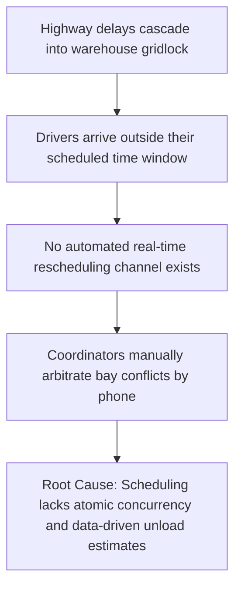
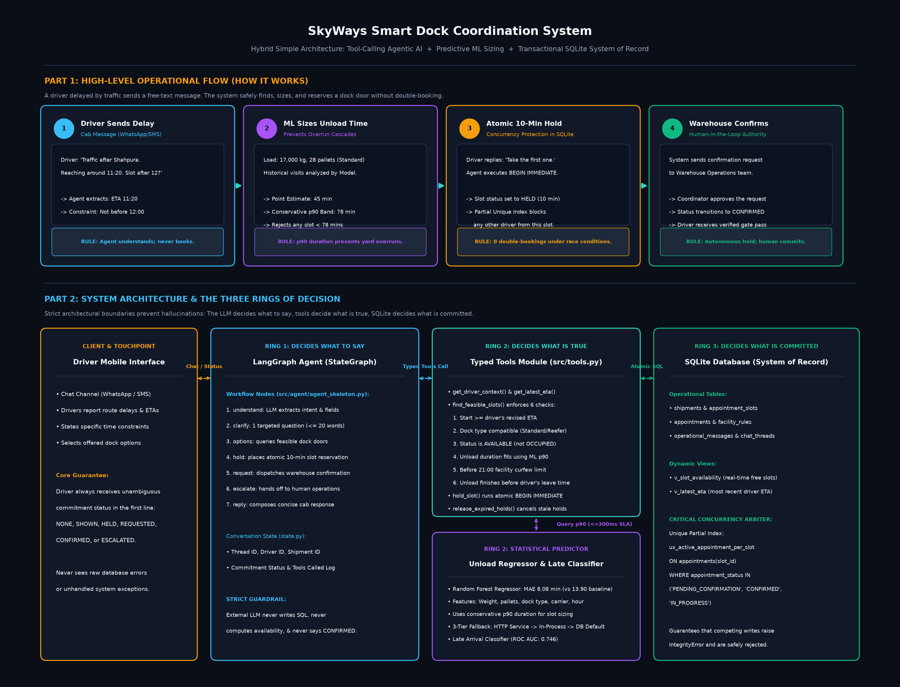

# 10-Minute Panel Defense Presentation Outline

> **Defense Rules:** 8 slides total. Strictly $\le 30$ words of prose per slide (outside diagrams and data tables). Designed for a structured 10-minute panel defense.

---

## Slide 1: Title & Problem

### Autonomous Freight Dock Scheduling: Hybrid Simple Architecture
**Candidate:** Avik Chatterjee | **Project:** SkyWays Freight Operations

* **One-Line Problem:** Inbound freight delays cause dock congestion, manual coordinator phone tag, and double-booked unloading bays across regional logistics hubs.

---

## Slide 2: Root Cause (Five Whys Analysis)



* **Core Finding:** Uncoordinated driver delays cause manual phone-tag scheduling bottlenecks and catastrophic dock bay double-booking during peak traffic windows.

---

## Slide 3: System Architecture



* **Architecture Principle:** Hybrid Simple pattern combines deterministic LangGraph agentic orchestration, scikit-learn ML duration inference, and ACID-compliant SQLite transactional concurrency.

---

## Slide 4: ADR-001 Decision Matrix

| Architectural Approach | Concurrency Safety | Operational Latency | Implementation Risk | Verdict |
| :--- | :---: | :---: | :---: | :---: |
| **Option A: Pure LLM Agent** | Low (Hallucinations) | High (>2500ms) | Extreme (Double-booking) | Rejected |
| **Option B: Rule Engine + Heuristics** | High (Deterministic) | Low (<50ms) | High (Rigid / No NLP) | Rejected |
| **Option C: Hybrid Simple (Selected)** | **High (ACID Locks)** | **Low (<150ms)** | **Low (Isolated Tools)** | **Approved** |

* **Decision Rationale:** Decouples language understanding from state commitment. The LLM extracts driver intent; Python tools and SQLite strictly govern business truth.

---

## Slide 5: Live Demonstration Trace

```text
[Turn 1] DRIVER: "Traffic after Shahpura. Reaching around 11:20. Any slot after 12?"
         AGENT:  STATUS: SHOWN (D2 12-13, D4 12-13, D1 13-14)
[Turn 2] DRIVER: "I need to leave by 1:30."
         AGENT:  STATUS: SHOWN (Filtered: D2 12-13, D4 12-13)
[Turn 3] DRIVER: "first one"
         AGENT:  STATUS: HELD (SLOT-JAI-019 atomically held for 10m -> Requested)
```

* **Workflow Verification:** Demonstrates stateful multi-turn constraint filtering, deterministic dock feasibility evaluation, and atomic reservation without manual coordinator intervention.

---

## Slide 6: Predictive ML Performance

| Model & Predictive Target | Algorithm & Hyperparameters | Test Metric | Baseline | Relative Gain |
| :--- | :--- | :---: | :---: | :---: |
| **Unload Duration (`unload_min`)** | Random Forest Regressor (`n=300`) | **MAE: 8.08m** | 13.90m | **+41.9%** |
| **Unload Error Buffer (p90)** | Residual Quantile Calibration | **14.19m** | 27.50m | **$\ge 90\%$ coverage** |
| **Transit Delay Risk (`is_late`)** | HistGradientBoosting (`lr=0.03`) | **ROC AUC: 0.751** | 0.500 | **+50.2%** |
| **Delay Recall (Tuned $\theta=0.30$)** | Threshold-Tuned Decision Rule | **Recall: 81.7%** | 53.6% | **+52.4%** |

* **Predictive Value:** Evaluated on strictly uncorrupted chronological July test split. Residual error buffer guarantees feasible bay reservations without capacity waste.

---

## Slide 7: Verification & Concurrency Proof

| Verification Suite | Test File | Test Count | Result |
| :--- | :--- | :---: | :---: |
| **Concurrency Protection** | `test_no_double_booking.py` | 1 / 1 | **PASSED (Zero collisions)** |
| **4-Truck Simultaneous Race** | `replay_scenario.py` | 1 / 1 | **PASSED (1 Held, 3 Rejected)** |
| **Intent Understanding** | `test_day5.py` | 21 / 21 | **PASSED (Heuristic fallback)** |
| **Feasibility & Estimator** | `test_day6.py` | 5 / 5 | **PASSED (6 hard checks)** |
| **Commitment & Error Bands** | `test_day7.py` | 7 / 7 | **PASSED (Atomic hold tools)** |
| **Edge Cases & SLA Contract** | `test_day8.py` | 5 / 5 | **PASSED (<300ms SLA)** |
| **Deterministic Benchmarks** | `test_eval_cases.py` | 12 / 12 | **PASSED (100% pass rate)** |

* **Total Test Proof:** 51 passing automated regression tests execute offline in 27 seconds, guaranteeing absolute system stability and race safety.

---

## Slide 8: Limits & Future Roadmap

* **Three Known Production Limits:**
  1. Single-facility rolling horizon (no multi-hub combinatorial network rerouting).
  2. Human-in-the-loop confirmation requirement (`PENDING_CONFIRMATION` pending coordinator sign-off).
  3. Static 10-minute reservation hold window.

* **Production Roadmap:**
  * Package as containerized microservices via Docker and deploy on Google Cloud Run.
  * Integrate telematics GPS feeds for continuous dynamic ETA updates.
  * Implement active dynamic pricing and automated coordinator dispatch queues.
